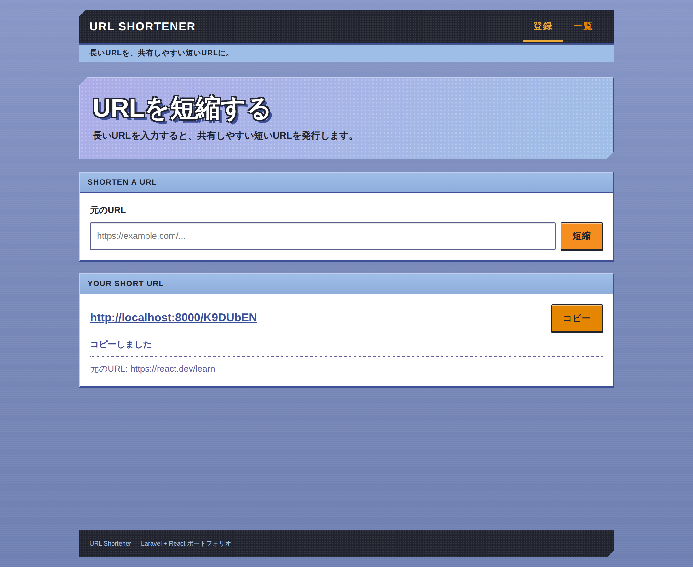
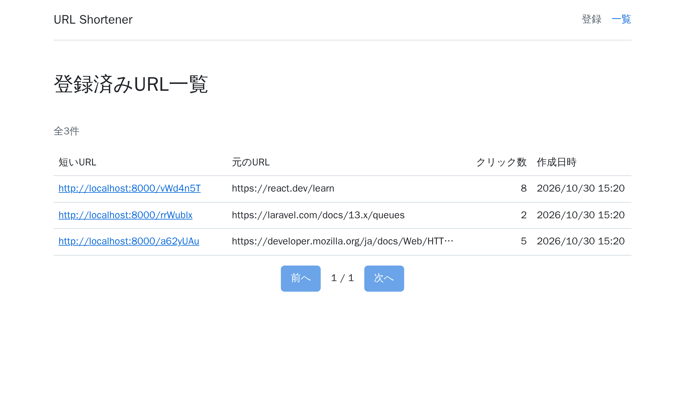
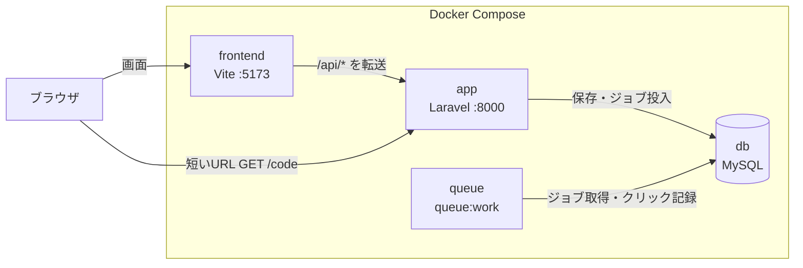

# URL短縮サービス


長いURLを短いURLに変換し、アクセス時に元のURLへ転送するWebサービスです。Laravel（API）と React + TypeScript（SPA）で作りました。

機能の数より、**設計判断の根拠・型安全・テスト・CI** によって品質を担保して作ることを重視しています。要件定義から設計、テスト設計までをドキュメントにまとめ、設計書が確定してから実装しています。

## 画面

| URL登録 | URL一覧 |
| --- | --- |
|  |  |

## 機能

| 機能 | 内容 |
| --- | --- |
| URL登録 | 長いURLを入力すると短縮コード（英数字7文字）を発行し、短いURLを返す。ワンクリックでコピーできる |
| リダイレクト | 短いURLへのアクセスで元のURLへ302で転送し、クリックを非同期で記録する |
| 一覧表示 | 登録済みURLをクリック数・作成日時とともに新しい順に表示する（1ページ20件） |

## 技術スタック

| 領域 | 技術 |
| --- | --- |
| バックエンド | PHP 8.5 / Laravel 13 |
| DB・キュー | MySQL 9.7（LTS）/ Laravel Queue（databaseドライバ） |
| フロントエンド | React 19 / TypeScript 5.9 / Vite 8 / React Router 8 / TanStack Query 5 |
| API型連携 | Scramble（OpenAPI生成）+ openapi-typescript + openapi-fetch |
| 静的解析・整形 | Larastan（最大レベル）/ Laravel Pint / ESLint（typescript-eslint strict）/ Prettier |
| テスト | Pest / Vitest + React Testing Library + MSW |
| 環境・CI | Docker Compose / GitHub Actions / Dependabot |

TypeScript は最新の7系ではなく5.9を採用しています。typescript-eslint と openapi-typescript がまだ7系に対応していないためです。

## システム構成



- 画面は Vite のプロキシ経由で同一オリジンから API を呼び出します（CORS を許可していません）
- 短いURLへのアクセスは Laravel が受け、転送と同時にクリック記録のジョブをキューに投入します。ジョブはキューワーカーが処理します

## セットアップ

必要なものは Docker（Docker Compose）だけです。PHP や Node.js をローカルに入れる必要はありません。

```sh
git clone https://github.com/fuga-setoguchi/url-shortener.git
cd url-shortener
docker compose up -d
```

初回は依存パッケージのインストール、環境設定ファイルの作成、マイグレーションを自動で行います（数分かかります）。起動したら次のURLを開きます。

| URL | 内容 |
| --- | --- |
| http://localhost:5173 | 画面（URL登録・一覧） |
| http://localhost:8000/docs/api | APIドキュメント（Scramble） |

停止は `docker compose down`、DBのデータも削除するときは `docker compose down -v` です。

### テスト・静的解析

```sh
# バックエンド
docker compose exec app composer test      # Pest
docker compose exec app composer analyse   # Larastan
docker compose exec app composer lint      # Pint

# フロントエンド
docker compose exec frontend npm test               # Vitest
docker compose exec frontend npm run typecheck      # tsc
docker compose exec frontend npm run lint           # ESLint
docker compose exec frontend npm run format:check   # Prettier
```

## 設計判断

| 論点 | 判断 | 理由 |
| --- | --- | --- |
| 短縮コード | 英数字ランダム7文字 | 連番は次のURLを推測されるため。62^7 ≒ 3.5兆通りあり、総当たりでも見つけられない |
| コードの重複 | DBの一意制約違反を検知して再生成（最大3回） | 事前の存在チェックは同時アクセスで重複を防げないため、一意制約を最終的な保証にした |
| 大小文字 | 区別する（照合順序 `utf8mb4_bin`） | MySQL の既定の照合順序は大小文字を区別せず、`abc` と `ABC` が衝突するため |
| リダイレクト | 302 | 301 はブラウザにキャッシュされ、2回目以降のクリックを記録できないため |
| クリック記録 | キューで非同期 | 転送の応答をDBへの書き込みで遅らせないため |
| API のバージョン | `/api/v1` を付ける。短いURLには付けない | 互換性を壊す変更を v2 として並行提供できるようにするため。短いURLは配布後に変えられない |
| API の型 | OpenAPI から生成し、CIで生成物の差分を検出 | バックエンドの変更がフロントエンドの型に必ず反映されるようにするため |
| テストのDB | MySQL（SQLite を使わない） | 照合順序など、本番と同じDBでしか確認できない動作があるため |

### セキュリティ

詳細は[方式設計書 6章](docs/02_architecture.md)にまとめています。

- 転送先URLは http/https のみ許可し、認証情報付きのURL（`https://google.com@evil.example` など）、このサービス自身の短いURL、改行や空白を含むURLを拒否する
- レート制限（API全体 60回/分、URL登録 10回/分、IP単位）
- セキュリティ関連ヘッダー（`nosniff`、`X-Frame-Options`、`Referrer-Policy`、APIには CSP と `no-store`）
- 元のURLは画面でリンクにせず、テキストとして表示する。`dangerouslySetInnerHTML` は ESLint で禁止
- Docker のポートは `127.0.0.1` にのみ公開し、コンテナは非rootで実行。DBはアプリ専用ユーザーで接続

ログイン機能がないため、一覧は誰でも閲覧できます。本番公開は対象外のため、このリスクは受け入れています（公開する場合はログイン機能が必要です）。

## 品質

- **型**：PHP は全ファイルで `declare(strict_types=1)`、Larastan は最大レベルで通過。TypeScript は `strict` に加えて `noUncheckedIndexedAccess` 等を有効化
- **テスト**：テスト設計書のケースIDをテスト名に付けて対応付けている。テストが不具合を検出できることを、わざと不具合を入れて失敗することで確認した
- **CI**：PR ごとに静的解析・整形チェック・テスト・依存パッケージの脆弱性チェック・生成物（OpenAPI・API型）の差分チェックを実行し、通過したものだけをマージする

## ドキュメント

| ドキュメント | 内容 |
| --- | --- |
| [プロジェクト計画書](docs/00_project-plan.md) | 目的・スコープ・完成の定義 |
| [要件定義書](docs/01_requirements.md) | 機能要件・非機能要件・設計論点の決定 |
| [システム構成・方式設計書](docs/02_architecture.md) | 構成・クラス設計・CI・セキュリティ設計 |
| [DB設計書](docs/03_database.md) | テーブル定義・インデックス |
| API詳細設計書 | [API-01 短縮URL登録](docs/api/API-01_create-short-url.md) / [API-02 一覧取得](docs/api/API-02_list-short-urls.md) / [API-03 リダイレクト](docs/api/API-03_redirect.md) |
| 画面設計書 | [SCR-01 URL登録](docs/screens/SCR-01_register.md) / [SCR-02 URL一覧](docs/screens/SCR-02_list.md) |
| [自動テスト設計](docs/tests/README.md) | テスト方針・ケース一覧 |

## 今後の拡張

有効期限、カスタムコード、クリック推移グラフ、ログイン（ユーザーごとのURL管理）。
