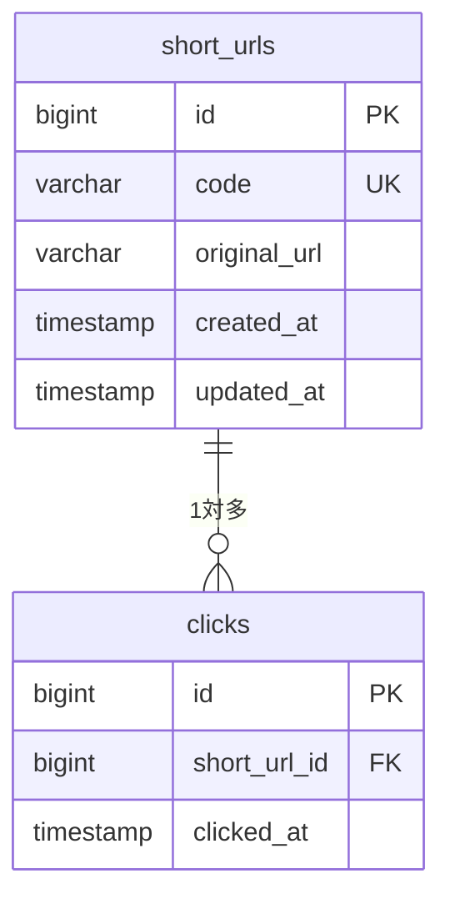

# DB設計書

作成日: 2026-10-29
ステータス: レビュー待ち
参照: [要件定義書](01_requirements.md)

## 1. 方針

- DBはMySQL、文字コードは `utf8mb4`
- 日時はUTCで保存する（`config/app.php` の `timezone` は `UTC` のまま）
- 外部キー制約を必ず張る

## 2. ER図

## 3. テーブル定義

### short_urls（短縮URL）

| カラム | 型 | NULL | 既定値 | 説明 |
| --- | --- | --- | --- | --- |
| id | BIGINT UNSIGNED | × | AUTO_INCREMENT | 主キー |
| code | VARCHAR(16) | × | | 短縮コード。照合順序 `utf8mb4_bin`（大小文字を区別）。MVPは7文字固定、将来のカスタムコード用に16文字まで確保 |
| original_url | VARCHAR(2048) | × | | 元のURL |
| created_at | TIMESTAMP | ○ | | 作成日時 |
| updated_at | TIMESTAMP | ○ | | 更新日時 |

| インデックス | カラム | 種類 | 用途 |
| --- | --- | --- | --- |
| PRIMARY | id | 主キー | |
| short_urls_code_unique | code | 一意 | リダイレクト時の検索、コード重複の最終的な防止 |
| short_urls_created_at_index | created_at | 通常 | 一覧の新しい順の並び替え |

### clicks（クリック）

| カラム | 型 | NULL | 既定値 | 説明 |
| --- | --- | --- | --- | --- |
| id | BIGINT UNSIGNED | × | AUTO_INCREMENT | 主キー |
| short_url_id | BIGINT UNSIGNED | × | | short_urls.id への外部キー（`ON DELETE CASCADE`） |
| clicked_at | TIMESTAMP | × | | クリック日時（アクセス時刻） |

| インデックス | カラム | 種類 | 用途 |
| --- | --- | --- | --- |
| PRIMARY | id | 主キー | |
| clicks_short_url_id_clicked_at_index | short_url_id, clicked_at | 複合 | クリック数の集計、将来の日別集計。外部キーのインデックスを兼ねる |

- clicks は追記のみで更新しないため `updated_at` を持たない（モデルは `$timestamps = false`）
- クリック数はカラムに持たず、一覧取得時に `withCount('clicks')` で集計する。MVPの規模では十分で、カウンタの更新競合や不整合を避けられる

## 4. Laravel標準テーブル

| テーブル | 扱い |
| --- | --- |
| jobs / job_batches / failed_jobs | 使用する（キュー） |
| cache / cache_locks | 使用する（レート制限のカウンタ） |
| users / password_reset_tokens / sessions | 使用しないため、初期マイグレーションから削除する（ログイン機能の追加時に戻す） |

## 5. モデル

| モデル | 関連 | 備考 |
| --- | --- | --- |
| ShortUrl | `hasMany(Click::class)` | `$fillable = ['code', 'original_url']` |
| Click | `belongsTo(ShortUrl::class)` | `$timestamps = false`、`clicked_at` は `datetime` キャスト |
